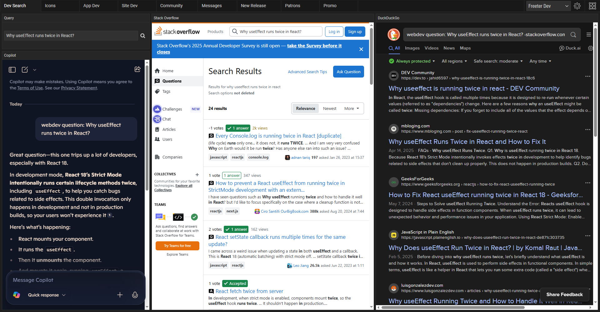
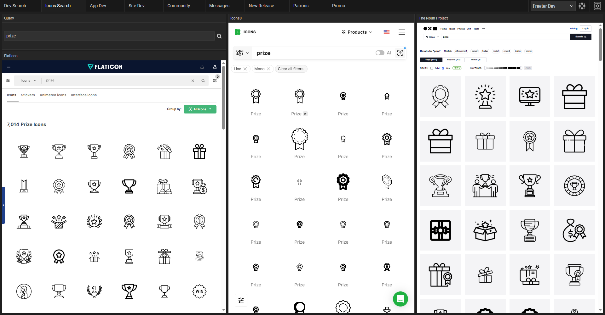

## Research Dev Topics Without Wasting Time

When you’re troubleshooting or researching something, you don’t want to waste time guessing which site might have the right answer. With Freeter, you can ask a question once and instantly see results from templated queries across multiple sources.

For example, you can pull answers from:

- **Copilot** → AI-powered suggestions
- **Stack Overflow** → peer-reviewed answers
- **DuckDuckGo** → broader web results

Here’s how to set up your **Workflow** in Freeter:

1. Add a **Web Query widget** for your search terms.
2. Add a **Webpage widget** with this URL:
`https://copilot.microsoft.com/?q=webdev+question%3A+QUERY`
3. Add another for Stack Overflow:
`https://stackoverflow.com/search?q=QUERY`
4. Add one for DuckDuckGo:
`https://duckduckgo.com/?q=webdev+question%3A+QUERY+-stackoverflow.com`

Now, every coding question gives you **three perspectives instantly** — saving you time and keeping your workflow focused.

## Find Icons in Seconds

If you’re a designer or front-end developer, you know how much time you can waste hunting for the right icon. With Freeter, you can set up an **icon search workflow** once and avoid repeating the same filters and searches over and over again.

For example, you often need **monochrome outline icons** from these popular icon repositories:

- **Flaticon**
- **Icons8**
- **The Noun Project**

Here’s how your **Workflow** setup looks in Freeter:

1. Add a **Web Query widget**.
2. Add a **Webpage widget** for Flaticon:
`https://www.flaticon.com/search?word=QUERY&color=black&shape=outline`
3. Add one for Icons8:
`https://icons8.com/icons/set/QUERY--technique-line--mono`
4. Add another for The Noun Project:
`https://thenounproject.com/search/icons/?q=QUERY&style=line`

Now, every keyword you type displays a gallery of matching icons from all three sources — **side by side**, saving you time and clicks.

## Search the Web Smarter, Work Faster

Next time you need to find something online, just press `Ctrl+Shift+F` to quickly bring up the Freeter window, open your search workflow, and get **instant results**.

With Freeter you:

- Eliminate tab overload
- Search multiple sites at once
- Run templated queries in seconds
- Stay focused on your workflow
- Enjoy a free, privacy-focused, open-source app with no ads or subscriptions

[Download Freeter](/download) today and **take your searches to ninja level**.
